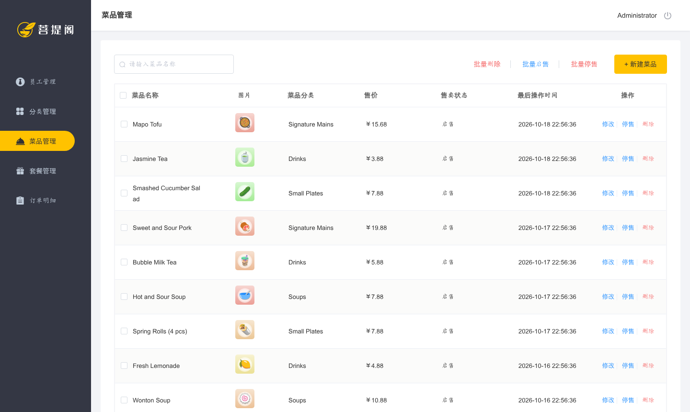
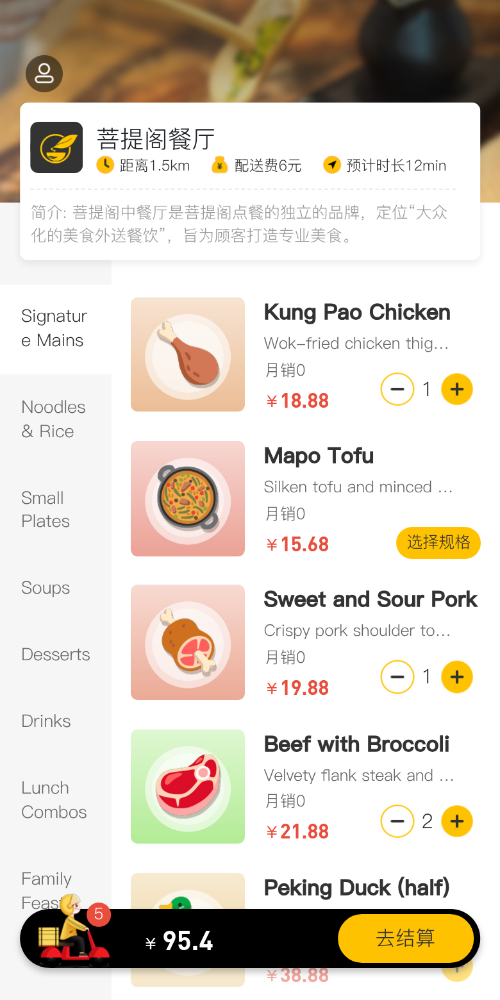
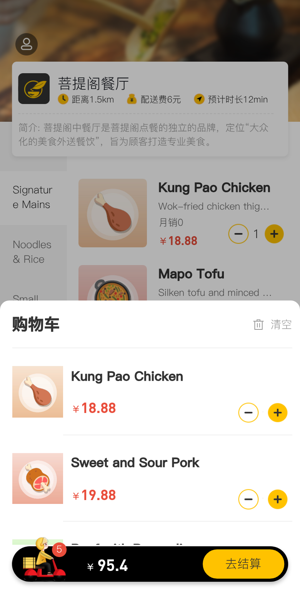
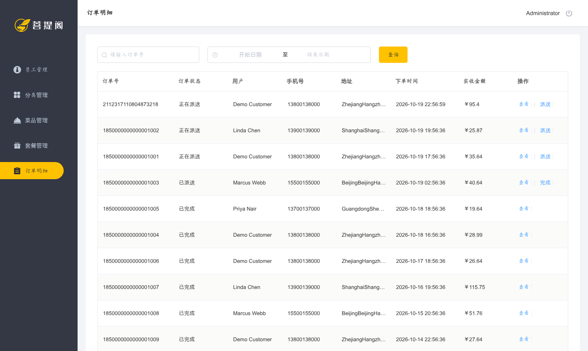
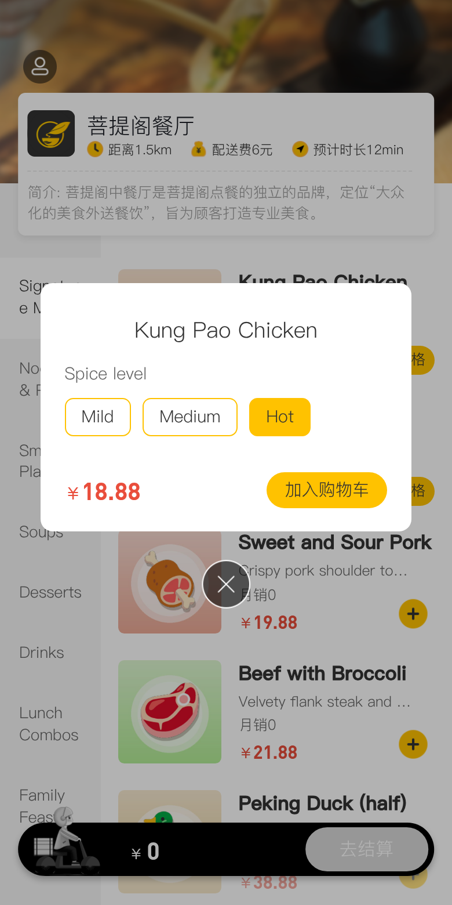
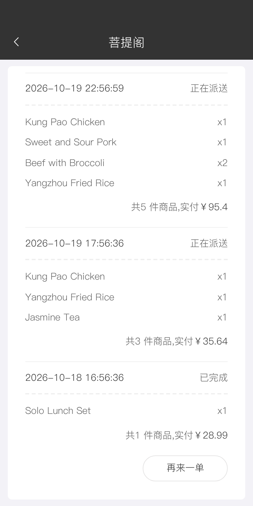
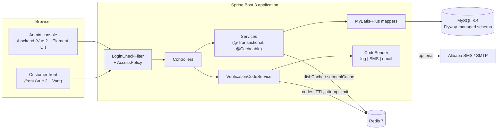

# onlineShopping

[](https://github.com/Ctwqk/onlineShopping/actions/workflows/ci.yml)

A food-ordering platform on **Spring Boot 3**: a restaurant **admin console** (dishes, combos, categories, staff,
orders) and a **mobile customer front** (phone login, menu, cart, address book, checkout, order history), backed by
MySQL and Redis. `docker compose up --build` gives you a seeded, fully usable stack.

| Admin console | Customer front (phone-sized) |
|---|---|
|  |   |
|  |   |

More: [admin login](docs/screenshots/admin-login.jpg), [combos](docs/screenshots/admin-setmeals.png),
[checkout](docs/screenshots/front-checkout.png), [customer login](docs/screenshots/front-login.png),
[API docs](docs/screenshots/api-docs.png). The screenshots were captured by
[`scripts/screenshots/capture.mjs`](scripts/screenshots/capture.mjs) (Playwright) against the Compose stack below.
The UI labels are Chinese because the static front-ends come from the course template (see [Origin](#origin)); the
demo data is English.

## Origin

This project started as the well-known **"Reggie" (瑞吉外卖) takeout course project**: the package name
`com.taiwei.reggie`, the Vue 2 / Element UI admin pages and the Vant mobile pages (still titled 瑞吉外卖管理端 /
菩提阁) are that course's template. The owner built the Spring backend on top of it and experimented with
read/write splitting, Redis caching and SMS / email codes (see the `RWsplit`, `email_impl` and `front_back_split`
branches).

The 2026 upgrade keeps that identity and adds what it lacked to run and be trusted:

- **Platform**: Spring Boot 2.4 -> 3.5, jakarta, Java 17+, current MyBatis-Plus / Druid / springdoc, a Flyway schema
  (the repository shipped no SQL), configuration through environment variables instead of an untracked
  `application.yml`.
- **Runs out of the box**: Dockerfile + Compose stack (MySQL, Redis, app), realistic demo data, SMS / email made
  optional (the code is logged, and echoed in the UI in dev mode).
- **Bug fixes** in the order, cart, address, cache, upload and auth code, plus the endpoints the UIs call that the
  backend never implemented (see [What was fixed](#what-was-fixed)).
- **Tests and CI**: 104 tests including Testcontainers integration tests over real MySQL + Redis, GitHub Actions.

## Features

Admin console (`/backend`)
- Employee login (BCrypt), staff list / create / enable-disable
- Dish categories and combo categories
- Dishes with images, flavour options and start / stop selling (single and batch)
- Combos (setmeals) composed of dishes
- Order list with order-number and time-range filters; dispatch -> complete workflow

Customer front (`/front`)
- Passwordless login with a 4-digit code (SMS / email / log channel)
- Menu by category with flavour selection, combo details dialog
- Cart with per-flavour rows, address book with a default address, checkout, order history, "order again"

Platform
- Redis-backed Spring Cache for the public menu, evicted on every catalogue change
- API documentation: Knife4j UI at `/doc.html`, Swagger UI at `/swagger-ui.html`, OpenAPI at `/v3/api-docs`
- Health probe at `/actuator/health`

## Architecture



Every request passes `LoginCheckFilter`, which asks `AccessPolicy` whether the endpoint is public, customer-only,
shared read-only catalogue, or admin-only, and checks the matching session attribute. Controllers are thin; business
rules (pricing, order life cycle, cache eviction, ownership checks) live in the service layer.

## Tech stack

Java 17+ (CI runs 17 and 21, the image runs 21) - Spring Boot 3.5 (Web, Validation, Actuator, Cache, Data Redis,
Mail) - MyBatis-Plus 3.5 - MySQL 8.4 + Flyway 11 - Druid 1.2 - Redis 7 - springdoc 2.8 + Knife4j UI 4.5 - Spring
Security Crypto (BCrypt only) - Lombok - JUnit 5, AssertJ, Testcontainers 1.21 - Docker / Compose - GitHub Actions.

## Quickstart (Docker)

Requirements: Docker with the Compose plugin. Nothing else (the Maven build happens inside the image build).

```bash
git clone https://github.com/Ctwqk/onlineShopping.git
cd onlineShopping
docker compose up --build             # first build takes a couple of minutes; add -d to detach
```

When the `app` container is healthy (about 10 s after the build):

| What | URL |
|---|---|
| Landing page | http://localhost:48080/ |
| Admin console | http://localhost:48080/backend/page/login/login.html |
| Customer front (use a phone-sized window / devtools device mode) | http://localhost:48080/front/page/login.html |
| API docs | http://localhost:48080/doc.html |

Stop and delete the data with `docker compose down -v`. Ports are configurable in `.env` (copy
[`.env.example`](.env.example)); MySQL and Redis are published on `127.0.0.1:43306` / `127.0.0.1:46379` only.

### Demo credentials (profile `dev`, the Compose default)

| Who | Login | Password / code |
|---|---|---|
| Admin console | `admin` | `123456` (the form is pre-filled) |
| Other staff | `manager`, `cashier` | `123456` |
| Disabled staff (shows "user banned") | `former.staff` | `123456` |
| Customer | phone `13800138000` ("Demo Customer": two addresses, past orders) | click *获取验证码*; in dev mode the server echoes the 4-digit code and the page fills it in |
| More customers | `13900139000`, `15500155000`, `13700137000` | same |

Seed data: 8 categories, 20 dishes (one stopped), flavour options, 3 combos, 4 staff, 4 customers with addresses and
14 orders in every state (2 awaiting dispatch, 1 dispatched, 10 completed, 1 cancelled). Dish images are small
generated illustrations (Noto Color Emoji on gradients) under `src/main/resources/seed-images`, not photographs.

### Run the app without Docker

```bash
docker compose up -d mysql redis                 # only the backing services
SPRING_PROFILES_ACTIVE=dev \
DB_URL='jdbc:mysql://localhost:43306/reggie?characterEncoding=utf-8&useSSL=false&allowPublicKeyRetrieval=true&serverTimezone=UTC' \
DB_PASSWORD=reggie REDIS_PORT=46379 \
mvn spring-boot:run                              # http://localhost:8080 (override with SERVER_PORT)
```

### Without demo data

Start with an empty `SPRING_PROFILES_ACTIVE` and give the first administrator a password:

```bash
SPRING_PROFILES_ACTIVE= REGGIE_ADMIN_PASSWORD='choose-a-password' docker compose up --build
```

If the database volume was seeded earlier, run `docker compose down -v` first for a truly empty database. Verification
codes are then only written to the application log (`docker compose logs app`).

## Configuration

Everything is an environment variable with a working default (see `src/main/resources/application.yml`).

| Variable | Default | Meaning |
|---|---|---|
| `DB_URL`, `DB_USERNAME`, `DB_PASSWORD` | local MySQL, `reggie` / `reggie` | datasource |
| `REDIS_HOST`, `REDIS_PORT`, `REDIS_PASSWORD` | `localhost`, `6379`, empty | Redis |
| `SERVER_PORT` | `8080` | HTTP port of the application |
| `REGGIE_IMAGE_PATH` | `./data/images/` | where uploaded dish images are stored |
| `SPRING_PROFILES_ACTIVE` | empty | `dev` = demo data + code echo |
| `REGGIE_ADMIN_USERNAME`, `REGGIE_ADMIN_PASSWORD` | `admin`, empty | creates the first admin if the employee table is empty |
| `REGGIE_VERIFICATION_CHANNEL` | `log` | `log`, `sms` or `email` |
| `REGGIE_SMS_ACCESS_KEY_ID`, `..._ACCESS_KEY_SECRET`, `..._SIGN_NAME`, `..._TEMPLATE_CODE` | empty | Alibaba Cloud Dysmsapi (channel `sms`) |
| `SPRING_MAIL_HOST`, `_PORT`, `_USERNAME`, `_PASSWORD`, `REGGIE_EMAIL_FROM` | empty | SMTP (channel `email`) |

The SMS and email channels fail fast at startup when their settings are incomplete. They have not been run against
real providers (no accounts were used); only the default log channel is exercised end to end.

## Tests

```bash
mvn test      # 50 fast unit tests, no Docker needed
mvn verify    # + 54 integration tests; needs a running Docker daemon (Testcontainers: mysql:8.4, redis:7-alpine)
```

The integration tests start the whole application against real MySQL (with the Flyway schema) and Redis and drive it
through the HTTP API with a session-keeping MockMvc client: authentication and the separation of admin and customer
sessions, catalogue CRUD with cache population / eviction, cart pricing and flavour rows, address ownership, order
submission with exact totals and re-pricing, order history and "order again", the admin order life cycle, image
upload hardening and the verification-code rules. Several of them pin bugs of the original code (see below).

## Project layout

```
src/main/java/com/taiwei/reggie/
  controller/   thin REST controllers            filter/    LoginCheckFilter + AccessPolicy
  service/      business rules (impl/)           security/  PasswordService (BCrypt + legacy MD5)
  mapper/       MyBatis-Plus mappers             notify/    code delivery: log / Alibaba SMS / email
  entity/ dto/  persistence models and views     config/    properties, Jackson, MyBatis-Plus, OpenAPI, bootstrap admin
  common/       R envelope, exceptions, audit-field filler, request-scoped user id
src/main/resources/
  backend/      admin console (static Vue 2 + Element UI)     front/    customer front (static Vue 2 + Vant)
  db/migration/ Flyway schema                                 db/demo/  demo data (profile dev only)
  seed-images/  images referenced by the demo data            application*.yml
src/test/       unit tests and Testcontainers *IT integration tests
docker/         MySQL init script                  scripts/screenshots/  Playwright capture script
Dockerfile, docker-compose.yml, .env.example, .github/workflows/ci.yml
```

## What was fixed

Found by reading the code and covered by the tests above:

- Cart rows merged by comparing `user_id` with the dish id; cart name / image / **price were trusted from the
  request**. The server now prices every cart row and every order from the catalogue.
- Order line items pointed at the cart row id instead of the order id; every order line was truncated to whole
  currency units (a `13.88 + 2 x 3.99 + 20.05` order, really `41.91`, was stored as `40`); checkout accepted other
  customers' addresses and withdrawn dishes.
- The UIs called endpoints that did not exist: order list / status change (admin), order history, "order again",
  cart "-", combo details, address update / delete, customer logout.
- Batch start / stop selling posted `1,2,3` to a `Long` parameter; cache invalidation used a non-wildcard `dish_*`
  key and ignored status changes, deletes and category moves.
- Admin logout cleared a request attribute instead of the session; any logged-in customer could call every admin
  endpoint; an admin and a customer in one browser shared an identity.
- `BaseContext` was never cleared on pooled threads; uploads kept client file names and allowed path traversal on
  download; passwords were unsalted MD5 and the hash was sent to the browser; `PUT /employee` could overwrite the
  password; the cart total showed `95.39999999` in the UI.
- Removed dead / unsafe code: a hard-coded recipient address in the mail helper, tests that sent real email.

## Design notes and trade-offs

- **Money**: dish and combo prices are stored in cents (the course UIs multiply / divide by 100); cart and order
  amounts are stored in currency units. `Money.centsToUnits` is the only conversion point; order totals are
  `BigDecimal` and priced at checkout time, so a price edit between "add to cart" and "pay" is honoured.
- **Access control by endpoint kind** (`AccessPolicy`) rather than "is anyone logged in": a table of
  public / customer / shared-read / admin rules, unit-tested; unknown paths default to admin-only.
- **Caching**: Spring Cache on Redis for the two public menu queries, `allEntries` eviction on any catalogue write.
  Eviction happens when the service method returns, just before the transaction commits, so a concurrent read can
  re-cache the old value for up to the 30-minute TTL; acceptable for a menu, not for stock levels.
- **Login codes**: Redis TTL, five wrong guesses invalidate the code, 30 s resend cooldown. The `dev` profile echoes
  the code in the response (`reggie.verification.expose-code`). Outside `dev`, the response never includes it,
  even if that flag is enabled. Verification and consumption use one atomic Redis script to prevent concurrent
  code reuse. Never activate the `dev` profile in production.
- **Checkout retries**: a database row lock serializes simultaneous submissions by the same customer before the
  cart is read, preventing duplicate orders for that cart. Availability is checked on every cart add, including
  increments of existing rows.
- **Passwords**: BCrypt; the original MD5 hashes still verify and are upgraded in place on first login.
- **ShardingSphere removed**: the JDBC read/write splitting needed a second MySQL just to start, and nothing in the
  code depended on it. To bring it back, ShardingSphere-JDBC 5.x (or a Spring `AbstractRoutingDataSource` with
  `@Transactional(readOnly = true)` routing) can wrap the same datasource. The `RWsplit` branch preserves the
  historical source and dependency, but has no tracked datasource/routing configuration; it is not a complete
  runnable setup.
- **Knife4j**: the 4.5 starter predates Spring Framework 6.2 and breaks against current springdoc, so only its UI is
  used (`knife4j.enable=false`, springdoc pinned to 2.8). `/doc.html` works; Knife4j's extra OpenAPI extensions are
  off.
- **Flyway + MySQL**: Flyway reads `performance_schema.user_variables_by_thread`, which unprivileged users cannot
  select; the Compose MySQL init script grants it (see `docker/mysql-init`). If you point the app at your own MySQL
  with a restricted user you need the same grant (or run the migrations with a privileged user).
- **Time**: audit columns use the JVM clock, the demo data uses MySQL `NOW()`; both are UTC in the containers.

## Known limitations and roadmap

- UI strings are Chinese (course template); an English / i18n pass over the static pages is not done.
- Email-code delivery is available through the API; the bundled customer login form accepts phone numbers only.
- No payment integration: checkout records the chosen method and creates the order as "awaiting dispatch".
- HTTP sessions live in the application's memory (single instance); Spring Session on Redis would fix that.
- Concurrent cart edits across tabs/devices are not coordinated with checkout.
- The admin UI offers dispatch and complete only; cancelling exists in the API (`PUT /order` with status 5) but has no
  button, and customers cannot cancel. There are no staff roles: every employee is an administrator.
- Uploaded images live on a local volume.
- `src/main/resources/front/fonts` contains PingFang SC and DIN font files that came with the course template; they
  are proprietary typefaces, so replace them with open fonts before deploying the front-end publicly.
- The Playwright screenshot script is manual; it is not part of CI.
- My code is released under the [MIT License](LICENSE). The course-template front-end assets and fonts are not covered by it.
